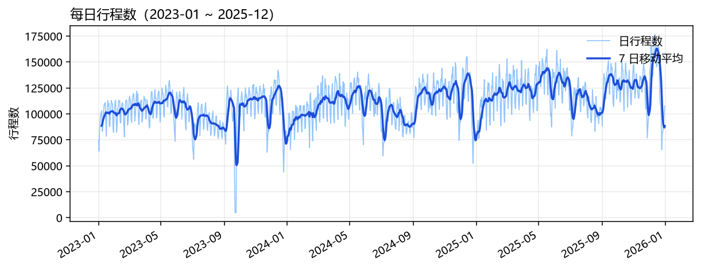

# NYC TLC 出行数仓 · 1.28 亿行真实数据的数据开发作品集

> 一句话：用 **NYC TLC 黄色出租车 2023–2025（36 个月，1.282 亿行，2.0 GB Parquet）**，
> 从 0 跑通 **ODS → DWD → DWS → ADS** 四层数仓，包含清洗/去重/维表补全/质量门禁/增量幂等/分区裁剪/
> 倾斜实验/Spark 对照/FastAPI/HTML 看板。**不是 SQL 练习，是一条可复现的链路。**

> **在线看板（GitHub Pages）**：`https://<你的用户名>.github.io/<仓库名>/`
> 发布方法见 [`docs/github_publish.md`](docs/github_publish.md)。



## 为什么选这个数据集

| | |
|---|---|
| 数据源 | [NYC TLC Trip Record Data](https://www.nyc.gov/site/tlc/about/tlc-trip-record-data.page)（官方、免登录） |
| 规模 | 36 个月，**128,202,548 行**，2.01 GB Parquet |
| 结构 | 1 张行程事实表 + 265 个 taxi zone 维表 + 1096 天天气维表 |
| 脏数据 | 跨月时间戳、负金额/退款、0 里程、超长行程、Vendor 记账口径差异 |
| 本机适配 | 16 GB 内存 / C 盘 44 GB 可用 / 无 Docker，DuckDB 3 GB 内存上限可跑完 |
| 为什么不选淘宝 | 用户已做过淘宝 UserBehavior，本项目换域，证明方法论可迁移 |

完整对比（GH Archive / Amazon Reviews / BTS / Citi Bike / TPC-DS / Olist）见 [`docs/dataset_selection.md`](docs/dataset_selection.md)。

## 架构

```text
TLC 官方 Parquet (36 月) ─┐
Taxi Zone (265)          ─┼─▶ ODS (pickup_year/month 分区)
Open-Meteo 天气 (1096 天) ─┘        │
                                    ▼
                         DWD 清洗/去重/维表补全/天气关联
                         122,349,675 行 · 4.32 GB · 36 分区
                                    │
              ┌─────────────────────┼─────────────────────┐
              ▼                     ▼                     ▼
      DWS zone_day/hour_day   DWS payment/borough     DWS zone_hour/weather
              └─────────────────────┼─────────────────────┘
                                    ▼
                 ADS 10 张表（日/月 KPI、区域榜、热力图、机场、小费、预测）
                                    │
                    ┌───────────────┴───────────────┐
                    ▼                               ▼
              DuckDB + Parquet                 FastAPI / HTML 看板
```

## 快速开始

```powershell
cd nyc_tlc_dw
python run_all.py                 # 全量：下载 → 维度 → ODS → DWD → DWS → ADS → 质量 → 性能 → 看板
python scripts/serve.py           # http://127.0.0.1:8000  API + 看板
```

已包含数据，`00_download.py` 会断点续传；重跑全链路约 15 分钟（ODS 5.2 min + DWD 4.9 min + 其余 1 min）。
> 若从 Git 克隆（`lib/` 与 `data/` 不入库），先 `pip install -r requirements.txt`，再运行 `python run_all.py`。

```text
只跑某几步： python run_all.py --only 03,04,05
跳过性能：   python run_all.py --skip-bench
```

## 实测结果

### 数据量

| 层 | 行数 | 大小 | 分区 |
|---|---:|---:|---:|
| 原始 | 128,202,548 | 2.01 GB | 36 文件 |
| ODS | 128,202,401 | 1.91 GB | 36 |
| DWD | **122,349,675** | **4.32 GB** | 36 |
| DWS | 251,873（zone_day） | < 50 MB | — |
| ADS | 1,096（日 KPI） | < 10 MB | — |

- 过滤掉 5.85M 条无效行程（时长/里程/金额/时间顺序），去重 5 条。
- 总收入 **$3,515,258,864**；平均客单价 **$28.73**；机场单占比 **7.89%**；信用卡小费率 **22.05%**。
- 覆盖 1,096 天、36 个月、253 个活跃 zone。

### 数据质量（18 条规则）

**17 PASS / 1 WARN / 0 FAIL**。唯一 WARN 是"分项金额 ≈ total_amount"（70.16%）：
TLC 不同 Vendor 对拥堵费/机场费的记账口径不同，收入统一以 `total_amount` 为准，规则只观测不阻断。
详见 [`output/quality_report.json`](output/quality_report.json)。

### 性能（本机实测，DuckDB 2.0 / 3 GB / 4 线程）

| 实验 | 结果 |
|---|---|
| CSV vs Parquet（同月 DWD） | 1.21 GB / 1.546s vs 0.116 GB / 0.085s（**10.4× 压缩，18× 查询**） |
| 分区裁剪（DWD 全量 vs 单月） | 0.261s vs 0.073s（**3.6×**） |
| 列裁剪（1 列 vs 6 列） | 0.312s vs 1.428s（**4.6×**） |
| 线程扩展 1/2/4/8 | 2.277 / 1.115 / 0.715 / 0.437s |
| 倾斜 Top1 zone 占比 | 4.63%（zone 237） |
| DuckDB 加盐 | 0.555s → 1.534s（单机无 shuffle，**如实记录变慢**） |
| **Spark 4.3 加盐** | **1.638s → 0.845s（提升 48.4%）**，同 4,966 行结果 |

完整数字见 [`output/benchmark.json`](output/benchmark.json)、[`output/spark_audit.json`](output/spark_audit.json)。

### 幂等

2025-12 分区连续跑两次：行数、收入、行级 hash **完全一致**；Parquet 字节不完全一致（并行写顺序），
以逻辑幂等为准。见 [`output/idempotency.json`](output/idempotency.json)。

## 技术栈（与 JD 对齐）

| JD 关键词 | 本项目落地 | 证据 |
|---|---|---|
| SQL / 窗口函数 | `lag`、`row_number`、7/28 日移动平均、z-score、TopN | `sql/05_ads.sql` |
| 数仓分层/维度建模 | ODS/DWD/DWS/ADS + 6 张维表 + 指标字典 | `docs/metric_dict.md` |
| Spark / Spark SQL | **Spark 4.3 + JDK 21 真跑** 2023-01 样本，broadcast join + 加盐 | `spark/`、`output/spark_audit.json` |
| Hive/Hadoop 分区 | `pickup_year=/pickup_month=` + Hive DDL | `sql/hive/` |
| 增量/幂等/调度 | 月分区覆盖写 + Airflow DAG + 运行清单 | `airflow/`、`output/run_manifest.json` |
| 数据质量/治理 | 18 条规则、`source_file` 血缘、质量门禁 | `scripts/06_quality.py` |
| Flink/实时 | Flink SQL 1h 滚动窗口 + Kafka source | `flink/sql/hourly_demand.sql` |
| 数据倾斜/性能 | Top zone 占比 + Spark 加盐 48.4% + 基准测试 | `scripts/07_benchmark.py` |
| Doris/ClickHouse | 两套 DDL + 选型说明 | `olap/` |
| Python/服务化 | 全链路 Python + FastAPI | `scripts/serve.py` |
| BI | 单文件 HTML 看板（离线可看） | `output/dashboard.html` |

## 目录

```text
nyc_tlc_dw/
├─ run_all.py                 # 一键编排（9 步）
├─ config.py                  # 路径/内存/阈值
├─ scripts/                   # 00~08 + serve.py
├─ sql/                       # 01_dim ~ 05_ads
├─ spark/                     # Spark 4.3 对照 + winutils
├─ airflow/                   # DAG（重试/质量门禁）
├─ flink/                     # Flink SQL
├─ olap/                      # ClickHouse/Doris DDL
├─ data/                      # raw/ods/dwd/dws/ads/dim
├─ db/nyc_tlc.duckdb          # 本地数仓（视图 + DWS/ADS 表）
├─ output/                    # dashboard/quality/benchmark/idempotency
├─ docs/                      # 选型/架构/口径/面试
└─ tools/                     # JDK 21 + Spark 4.3 + winutils（免安装）
```

## 已知边界（面试时主动说）

- 本机没有 Hadoop/Hive/Docker 集群，Hive 只给 DDL，Flink/ClickHouse 只给可执行 SQL，不冒充"生产集群经验"。
- Spark 在 Windows 下写 Parquet 会被 winutils/ACL 拦 chmod，所以 Spark 只做内存计算验证；全量落盘由 DuckDB 完成。
- TLC 的 `total_amount` 与分项不是 100% 可对账，这是真实数据问题，已作为 WARN 记录，不硬洗。
- 天气按天关联，不逐小时；小费只统计信用卡，现金小费不可观测。

## 文档

- [数据集选型对比](docs/dataset_selection.md)
- [架构与实现细节](docs/architecture.md)
- [指标口径字典](docs/metric_dict.md)
- [17 条 JD 映射](docs/jd_mapping.md)
- [面试问答](docs/interview.md)

## 数据许可

NYC TLC 公开数据（NYC Open Data），可自由用于分析与作品集；请勿二次分发原始数据文件。
Open-Meteo 数据遵循其非商业使用条款。
